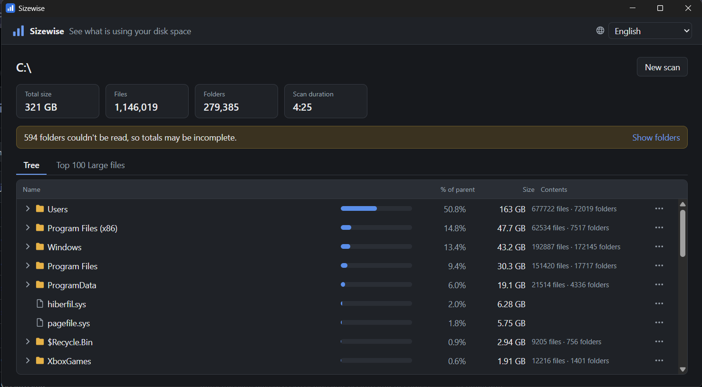
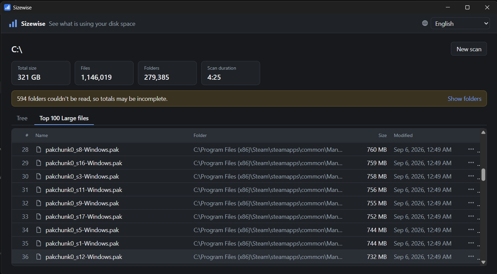

# Sizewise

[](https://github.com/joaolucasmm/sizewise/actions/workflows/ci.yml)
[](LICENSE)

A lightweight, open-source Windows app that shows **where your disk space is going**: which folders and Large files take up a drive, without ever touching anything on its own.

Windows Explorer doesn't show folder sizes, and most "PC optimizers" are heavy, full of ads, or delete things you don't understand. Sizewise only reads: it scans a drive or folder, shows the result as a tree sorted by size plus the 100 biggest files, and lets you open any item in Explorer to decide yourself.



## Features

- **Scan a whole drive or a single folder.** The start screen lists your drives with total and free space.
- **Fast, parallel Standard scan** that needs no administrator rights, with live progress (current folder, files read, size so far, elapsed time) and a Cancel button that stops within moments.
- **Folder tree sorted by size** — files and subfolders mixed, each with a readable size, % of its parent, a proportional bar and file/folder counts. Children load on demand and the list is virtualized, so even a full `C:` result stays smooth.
- **Top 100 Large files** across the whole Target, with folder, size and modification date.
- **Honest results.** Folders that can't be read are listed instead of silently ignored; cancelled Scans are marked as incomplete; junctions and symbolic links are never followed, so nothing is counted twice.
- **Open in Explorer** (with the item selected) and **Copy path** on every item. There is no action that changes or deletes files.
- **English and Brazilian Portuguese**, following your Windows language, with a switcher that is remembered.



## Download

Get the installer (`Sizewise_x.y.z_x64-setup.exe`) from the [latest release](https://github.com/joaolucasmm/sizewise/releases/latest). It installs for the current user only and runs without administrator rights.

### About the SmartScreen warning

Sizewise is a personal open-source project and its installer is **not code-signed** (certificates cost money every year). Windows SmartScreen therefore shows *"Windows protected your PC"* the first time you run it. This is expected for unsigned apps:

1. Click **More info**.
2. Click **Run anyway**.

If you'd rather not trust a binary, every release is built by [GitHub Actions](.github/workflows/release.yml) from the tagged source, and you can [build it yourself](#build-from-source).

## Stack and architecture

| Layer | Technology | Role |
| --- | --- | --- |
| UI | Vue 3 + TypeScript + vue-i18n (Vite) | Displays data and sends commands; no business logic. |
| App | Tauri 2 (Rust) | Thin layer translating UI commands and events to the core. |
| Core | `scanner` crate (Rust, rayon) | Parallel traversal, result tree, queries. No Tauri dependency, fully tested. |

```
Vue UI ──commands──▶ Tauri app crate ──▶ scanner crate
       ◀──events───  (src-tauri)         (crates/scanner)
```

- The whole result tree **stays on the Rust side**, flattened into one array where each folder's children are contiguous and pre-sorted. The UI only asks for one page of a folder's children when you expand it, plus the Top 100, so memory and IPC traffic stay low even with millions of items.
- Traversal runs on a rayon thread pool; progress is rate-limited to about 10 events per second and cancellation is cooperative.
- Sizes are **logical** sizes (what Explorer shows as "Size").
- Structural decisions are recorded in [docs/adr](docs/adr/) and the vocabulary in [GLOSSARY.md](GLOSSARY.md); the roadmap is in [docs/PLAN.md](docs/PLAN.md).

## Performance baseline

Standard scan of a full `C:` drive, as the baseline for the planned MFT-based Fast scan:

| | Cold (first run after boot) | Warm (file system cache populated) |
| --- | --- | --- |
| Duration | 325.1 s | 6.9 s |

`C:` with 316.7 GB used, 1,140,406 files and 277,373 folders (594 unreadable without admin), measured on 2026-10-17 on an Intel Core i5-1335U (12 threads), 16 GB RAM, 512 GB NVMe SSD (NTFS), Windows 11, release build. Reproduce with:

```bash
cargo run --release -p scanner --example baseline -- C:\
```

The cold number is dominated by reading folder metadata from disk one folder at a time; that is the cost the Fast scan (reading the MFT in one pass) is meant to remove.

## Build from source

Prerequisites (Windows 10/11):

- [Rust](https://rustup.rs/) (stable, MSVC toolchain)
- [Visual Studio Build Tools](https://visualstudio.microsoft.com/visual-cpp-build-tools/) with the **Desktop development with C++** workload (MSVC + Windows SDK)
- [WebView2 Runtime](https://developer.microsoft.com/microsoft-edge/webview2/) (already present on Windows 11)
- [Node.js](https://nodejs.org/) 22 or newer

```bash
npm install
npm run tauri dev      # run in development mode
npm run tauri build    # build the installer into target/release/bundle/nsis
```

Checks run by CI:

```bash
npm run lint && npm run build
cargo fmt --all --check
cargo clippy --workspace --all-targets -- -D warnings
cargo test --workspace
```

The `scanner` tests build real file trees in temporary folders, including unreadable folders, junctions pointing to an ancestor and paths longer than 260 characters.

## License

[MIT](LICENSE)
